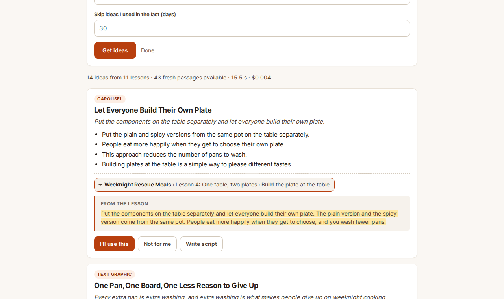
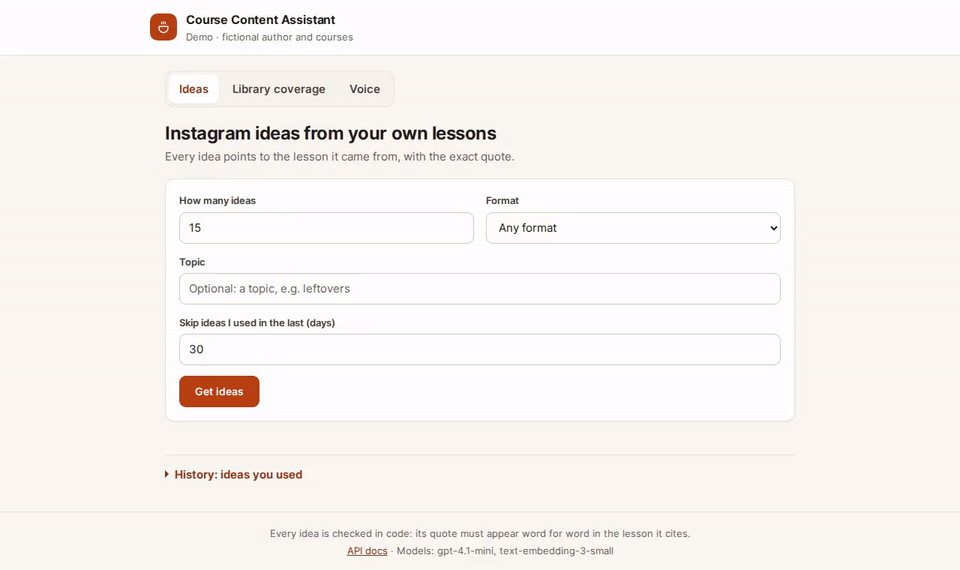
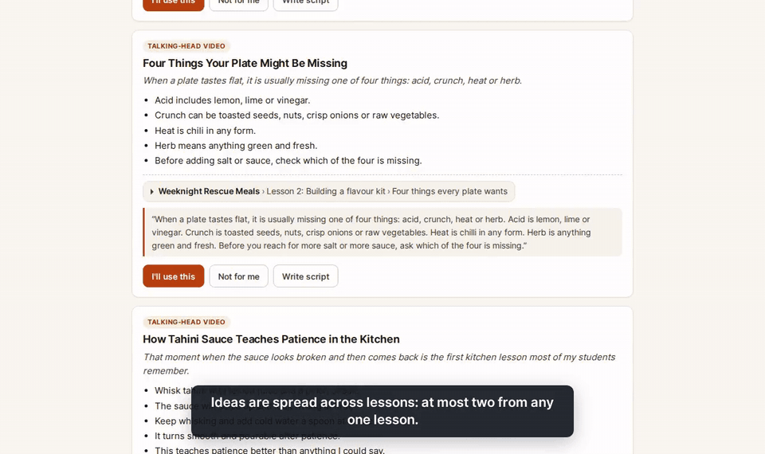
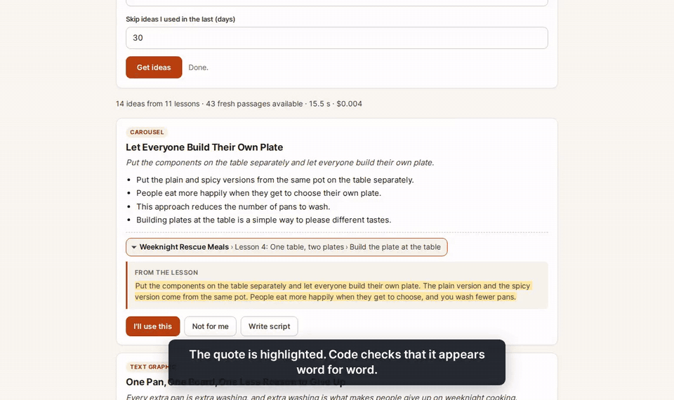
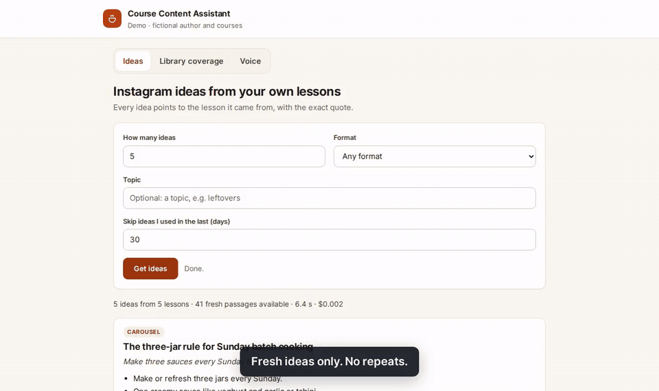
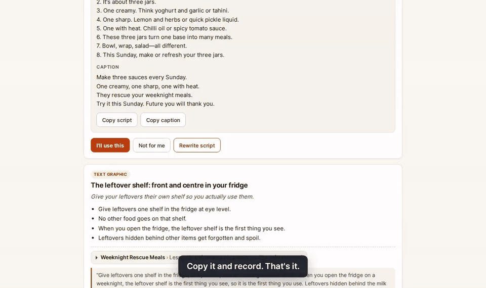
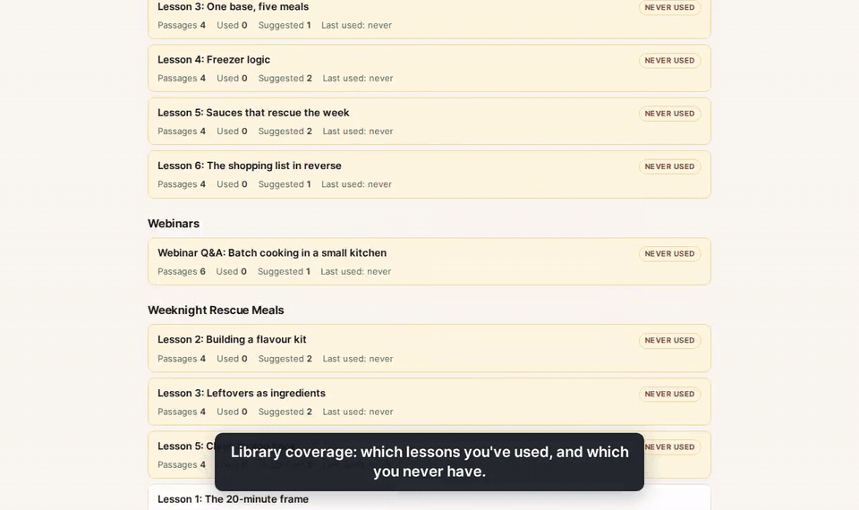

# Course Content Assistant

Content ideas for course creators, pulled from their own lessons. Every idea names the course, lesson and section it came from and quotes the lesson word for word. Code checks the quote, so an idea that can't be traced back to the author's material never reaches the screen.

The demo author is **Mira Calder of The Batch Kitchen**, a home-cooking and weekly meal-prep teacher. She, her school, her two courses and her posts are **invented for this demo**.



---

## The problem

A course creator has years of lessons, webinars and posts. When she asks a general chatbot for content ideas, she gets the same broad topics everyone gets, in a voice that isn't hers, and nothing tells her which lesson an idea is based on or whether she already posted about it last month.

This assistant is built around four rules:

1. **Ideas come from her material, and you can check it.** Each idea is built on one passage of a lesson and carries an exact quote from it. Code looks for the quote in the passage. Not found, or too short to prove anything: the idea is dropped and the screen says why.
2. **No repeats.** Ideas she marks as used are logged. Passages she used in the last 30 days (configurable) are skipped, lessons she has used least come first, and one request takes at most two passages from any one lesson.
3. **Her voice, written down.** Scripts follow her style sheet (phrases she uses, words she never says) and her past posts.
4. **Flag what the model added.** If an idea or a script mentions a number that isn't in the source passage, or a phrase from her "never say" list, it gets a visible warning. In testing, the model once titled an idea "Five different dinners" for a passage that says "four dinners". Cards now flag that.

## Video guides

Short screen recordings with captions, no voice. Each shows one task. They play below as GIFs; the sharper mp4 files are in [`assets/videos`](assets/videos).

### 1. Get ideas

Ask for 15 ideas in any format, optionally on a topic.



### 2. Check the source

Open the lesson passage behind an idea, with the quote highlighted.



### 3. Mark ideas you'll use

Mark two ideas as used, ask again, get only fresh passages.



### 4. Write a script

Turn an idea into a script and caption in her voice.



### 5. Library coverage

See which lessons have never been used.



### 6. Voice

The style sheet and sample posts the scripts follow.



They are recorded by `scripts/record_guides.py` against a running server, mp4 and GIF together, so they can be re-made after any change.

## Results (live run)

`course-assistant eval` runs the whole flow against the real models on a copy of the index with an empty ideas log: three rounds of 15 ideas, marking every kept idea as used after each round, then a topic request and three scripts. Run on 27 Oct 2026 with `gpt-4.1-mini` and `text-embedding-3-small`. Full report: [`eval/report.md`](eval/report.md).

| Round | Proposed | Kept (quote verified) | Lessons | Repeats | Fresh passages at start |
|---|---|---|---|---|---|
| 1 | 15 | 15 | 12 | 0 | 43 |
| 2 | 15 | 15 | 11 | 0 | 28 |
| 3 | 13 | 13 | 9 | 0 | 13 |

- Topic "leftovers": 5 asked, the search found 5 passages, 5 ideas kept, 4 of them from passages that use the word.
- Scripts: 3 written, no warnings.
- Whole run: 7 model calls, estimated cost $0.016.
- Round 3 asks for 15, but only 13 fresh passages are left after rounds 1 and 2. That is the "no repeats" rule working on a small library.

The same check, run six times with the current prompt: 256 ideas proposed, 255 kept (one dropped because its quote was under 8 words), 0 repeats. The topic request kept 5 of 5 in five runs; in one run the model wrote a single idea and skipped the other passages, which the prompt allows when a passage has nothing worth posting. One request for 15 ideas took 10 to 22 seconds and cost about $0.004. A request for 30 returns at most 24 ideas from this library (12 lessons, two passages each), took 24 seconds and cost $0.007.

An earlier version of the prompt asked for a single sentence as the quote. Mira writes in very short sentences, so a few ideas per round were dropped as "quote too short to check". The prompt now allows two or three sentences that stand next to each other in the lesson. The 8-word minimum and the code check stayed the same.

## Quick start

```bash
git clone https://github.com/alvi252/course-content-assistant.git
cd course-content-assistant
python3.11 -m venv .venv && . .venv/bin/activate
pip install -e ".[dev]"
cp .env.example .env            # add your OPENAI_API_KEY
course-assistant ingest         # index data/library
course-assistant serve          # open http://127.0.0.1:8000
```

From the terminal:

```bash
course-assistant ideas --count 5 --format carousel --topic leftovers
course-assistant eval --rounds 3 --out eval    # the live check above (makes paid calls)
```

With Docker:

```bash
docker build -t course-content-assistant .
docker run -p 127.0.0.1:8000:8000 -e OPENAI_API_KEY=sk-... -v course-data:/app/var course-content-assistant
```

The `/app/var` volume holds the index and the ideas log, so marked ideas survive a restart.

## Use your own material

```
data/
  library/
    <course-name>/01-<lesson>.md      one file per lesson, H2/H3 sections
    webinars/<name>.md                transcripts work the same way
  voice/
    style.md                          tone notes, "## Phrases I use", "## Never say"
    samples/<name>.md                 past posts, front matter: title, format
```

Markdown, plain text and PDF (`pip install -e ".[pdf]"`) are supported. The course name comes from the folder name, the lesson name from the file's title. Audio and video need a transcript first; this demo does not transcribe.

## How it works

1. **Ingest.** Lessons are split by heading into passages and embedded. Only new or changed files are processed (the indexing and search code comes from our earlier [docs-assistant-rag](https://github.com/alvi252/docs-assistant-rag) demo).
2. **Select.** Without a topic: passages used least, from lessons used least, at most two per lesson, skipping passages used in the last N days and very short ones. With a topic: hybrid search (vectors + BM25), best matches first, with the same day window and per-lesson limit.
3. **Generate.** One model call with the numbered passages and a summary of her voice. The model returns strict JSON: passage number, format, title, hook, outline, quote.
4. **Check.** Code drops ideas that point to a passage it wasn't given, reuse a passage, have the wrong format, or whose quote is shorter than 8 words or not in the passage (after evening out quotes, dashes, spaces and case). Ideas that add numbers get a warning.
5. **Log.** Kept ideas are saved as "suggested". "I'll use this" marks them used; "Not for me" dismisses them. The log is never deleted by re-indexing.
6. **Script.** One call with her style sheet, up to five past posts (same format first) and the full source passage. Warnings for numbers not in the passage and for "never say" phrases.

## API

| Method | Path | What it does |
|---|---|---|
| POST | `/ideas` | `{count, format, topic, skip_used_days}` → ideas, dropped ideas and why, usage |
| GET | `/ideas?status=used` | the ideas log |
| POST | `/ideas/{id}/use`, `/dismiss`, `/reset` | change an idea's status |
| POST | `/ideas/{id}/script` | script and caption in the author's voice, with warnings |
| GET | `/coverage` | per lesson: passages, ideas suggested and used, last used |
| GET | `/voice` | style sheet, phrases, "never say" list, samples |
| GET | `/formats`, `/documents`, `/health` | reference data and status |
| POST | `/ingest` | re-index (needs `X-Admin-Token` if `ADMIN_TOKEN` is set) |

Interactive docs at `/docs`. All settings are environment variables, listed with defaults in [`.env.example`](.env.example).

## Quality

- 223 tests with fake models, including doctests for every check: no network in tests.
- `ruff` and `mypy` clean (every function typed).
- The page is plain HTML, CSS and JavaScript with no build step and no third-party requests, under a strict Content Security Policy. Server data is never inserted as HTML.

```bash
python -m pytest -q && ruff check . && mypy src
```

## Limits

- The author, courses and posts are fictional. Prompts are written in English.
- The model can skip a passage it finds weak, so a request can return fewer ideas than asked. The summary line says how many came back.
- A verified quote proves the idea is anchored in the lesson. It doesn't prove the idea is good: she still picks.
- The number check is a simple rule (digits and number words), not an understanding of the text. It flags; it never rewrites.
- Claude is supported in the code (`LLM_PROVIDER=anthropic`) and covered by unit tests, but this demo was only run live with OpenAI.
- One author, one library, no user accounts. Anyone who can reach the port can ask for ideas, and every request is a paid model call, so keep it on localhost (as in the commands above) or behind your own login. `ADMIN_TOKEN` only protects re-indexing.
- "No repeats" follows the quote, not the file: after you edit or rename a lesson, a used idea is matched to the passage that still contains its quote, or to the same section if you rewrote the quoted sentence. If you rename that section as well, the passage counts as fresh again.

## License

MIT
